<p align="center">
  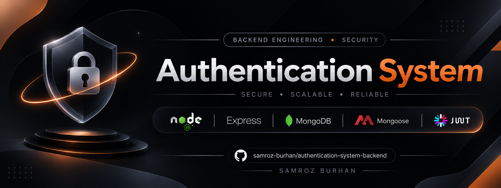
</p>

<h1 align="center">🔐 Auth Project</h1>

<p align="center">
  <b>A secure authentication back end for modern apps</b><br/>
  Verify emails, sign users in, manage device sessions, and protect every request.
</p>

<p align="center">
  
  
  
</p>

<p align="center">
  <a href="#-overview">Overview</a> •
  <a href="#-tech-stack">Tech Stack</a> •
  <a href="#-how-it-works">How It Works</a> •
  <a href="#-architecture">Architecture</a> •
  <a href="#-sequence-diagrams">Sequence Diagrams</a> •
  <a href="#-api-reference">API</a> •
  <a href="#️-setup">Setup</a> •
  <a href="#-author">Author</a>
</p>

---

## 📖 Overview

**Auth Project** is the back end for a simple but secure account system. Think of it as the front desk for your app:

| Step | What happens |
|:---:|---|
| 📝 | A person **registers** with a username, email, and password |
| 📧 | A **six-digit code** is emailed to confirm the address |
| 🔑 | The person **signs in** and gets a short-lived access token |
| 🍪 | A **refresh cookie** keeps them signed in safely |
| 🛡️ | Every protected request is checked against an **active session** |
| 🚪 | **Sign-out** revokes one device, or all of them |

---

## 🧰 Tech Stack

<p align="center">
  <b>🟢 Runtime and language</b><br/><br/>
  
  
  
</p>

<p align="center">
  <b>⚡ Backend and database</b><br/><br/>
  
  
  
</p>

<p align="center">
  <b>🔐 Authentication and security</b><br/><br/>
  
  
  
  
</p>

<p align="center">
  <b>📧 Email delivery</b><br/><br/>
  
  
  
</p>

<p align="center">
  <b>🛠️ Configuration, logging, and development</b><br/><br/>
  
  
  
</p>

<br/>

### 📚 What each tool does

| | Tool | Role in this project |
|:---:|---|---|
|  | **Node.js** | Runs the server |
|  | **Express** | Routes HTTP requests and runs middleware |
|  | **MongoDB** | Stores users, email codes, and sessions |
| 🗄️ | **Mongoose** | Defines schemas and models for MongoDB |
|  | **jsonwebtoken** | Creates and verifies access and refresh tokens |
| 🔒 | **bcrypt** | Hashes passwords and compares login attempts safely |
| 🚦 | **express-rate-limit** | Limits repeated requests per IP address |
| 🍪 | **cookie-parser** | Reads the HTTP-only refresh cookie |
|  | **Gmail OAuth2** | Authorizes the account used to send email |
|  | **Google OAuth2** | Provides the OAuth2 credentials for Gmail |
| 📨 | **Nodemailer** | Builds and sends verification emails |
| ⚙️ | **dotenv** | Loads settings from the `.env` file |
| 📜 | **Morgan** | Logs HTTP requests in development |
|  | **npm** | Installs packages and runs scripts |
|  | **nodemon** | Restarts the server on file changes (`npm run dev`) |
| 🧪 | **Vitest** | Runs unit tests once or in watch mode |

---

## 📖 How It Works

The system uses **two tokens**, each with one job:

| | 🎫 Access token | 🍪 Refresh token |
|---|---|---|
| **Lifetime** | 15 minutes | 7 days |
| **Stored in** | Frontend memory | `HttpOnly` cookie |
| **Sent as** | `Authorization: Bearer <token>` | Automatically by the browser |
| **Purpose** | Proves identity on protected routes | Gets a fresh access token |

Each login creates a **session** for that browser or device. The access token is useless once its session is revoked.

> [!IMPORTANT]
> An access token alone is **not enough**. The server also checks that its session is still active, unexpired, and not revoked.

---

## ✨ Highlights

- 🔐 **Passwords** hashed with bcrypt; hashes are never returned by normal queries
- 📧 **Email verification** with cryptographic codes, expiry, and attempt limits
- 🧾 **Device sessions** tracked in MongoDB, each with its own revocation
- 🔄 **Refresh-token rotation** with reuse detection
- 🍪 **Secure cookies** that are `HttpOnly`, `SameSite=Strict`, and `Secure` in production
- 🌐 **Origin checks** that allow only your configured frontend
- 🚦 **Rate limits** on login, registration, verification, and refresh
- 🧪 **Unit tests** for validation, tokens, limits, and origins

---

## 🏗️ Architecture

How a request moves through the codebase:

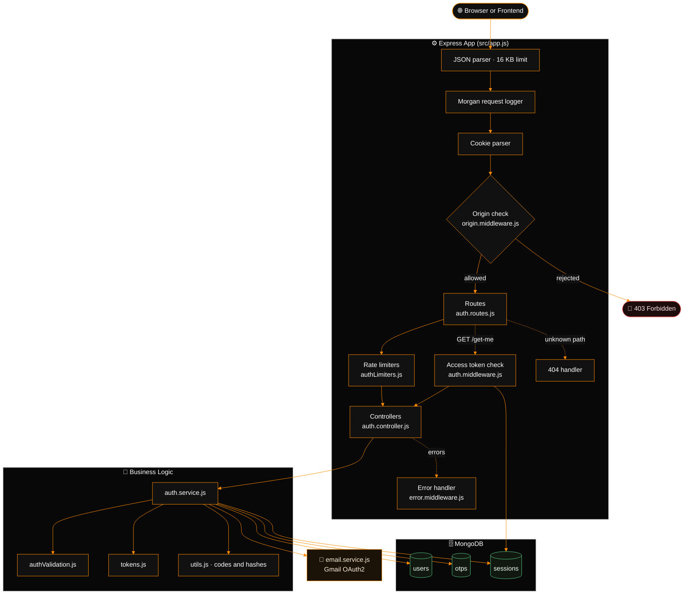

> **Startup:** `server.js` loads and checks configuration, connects to MongoDB, and only then starts listening. A failed first connection stops the process.

---

## 🔄 Sequence Diagrams

Each endpoint has its own diagram. The journey below shows how they connect.

### 🗺️ End-to-end journey

```mermaid
%%{init: {'theme': 'base', 'themeVariables': {'background': '#000000', 'primaryColor': '#111111', 'primaryTextColor': '#ffffff', 'primaryBorderColor': '#ff8c00', 'lineColor': '#ff8c00', 'secondaryColor': '#181818', 'tertiaryColor': '#222222', 'textColor': '#f5f5f5', 'mainBkg': '#111111', 'nodeBorder': '#ff8c00', 'clusterBkg': '#080808', 'clusterBorder': '#666666', 'titleColor': '#ffffff', 'edgeLabelBackground': '#111111', 'actorBkg': '#111111', 'actorBorder': '#ff8c00', 'actorTextColor': '#ffffff', 'actorLineColor': '#ff8c00', 'signalColor': '#f5f5f5', 'signalTextColor': '#ffffff', 'labelBoxBkgColor': '#111111', 'labelBoxBorderColor': '#ff8c00', 'labelTextColor': '#ffffff', 'loopTextColor': '#ffffff', 'noteBkgColor': '#111111', 'noteBorderColor': '#ff8c00', 'noteTextColor': '#ffffff', 'activationBkgColor': '#222222', 'activationBorderColor': '#ff8c00', 'sequenceNumberColor': '#000000', 'stateBkg': '#111111', 'stateBorder': '#ff8c00', 'stateLabelColor': '#ffffff', 'transitionColor': '#ff8c00', 'fontFamily': 'Segoe UI, Helvetica, Arial'}}}%%
sequenceDiagram
    autonumber
    actor P as 👤 Person
    participant B as 🌐 Browser
    participant API as ⚙️ Express API
    participant DB as 🗄️ MongoDB
    participant M as 📧 Gmail OAuth2

    rect rgb(12, 12, 12)
    Note over P,M: 1 · Registration and verification
    P->>B: Submit username, email, password
    B->>API: POST /register
    API->>DB: Save user (verified = false) and OTP hash
    API->>M: Send six-digit code
    API-->>B: 201 Created
    P->>B: Enter code from email
    B->>API: POST /verify-email
    API->>DB: Consume OTP, set verified = true
    API-->>B: 200 OK
    end

    rect rgb(16, 16, 16)
    Note over P,DB: 2 · Sign in
    P->>B: Submit email and password
    B->>API: POST /login
    API->>DB: Create session
    API-->>B: accessToken (JSON) + refresh cookie
    end

    rect rgb(20, 20, 20)
    Note over B,DB: 3 · Protected request and refresh
    B->>API: GET /get-me (Bearer access token)
    API->>DB: Confirm session is active
    API-->>B: username and email
    B->>API: POST /refresh-token (refresh cookie)
    API->>DB: Rotate refresh-token hash
    API-->>B: New accessToken + new refresh cookie
    end

    rect rgb(24, 24, 24)
    Note over B,DB: 4 · Sign out
    B->>API: POST /logout (refresh cookie)
    API->>DB: Revoke session
    API-->>B: 200 OK, cookie cleared
    end
```

---

### 1️⃣ Register · `POST /register`

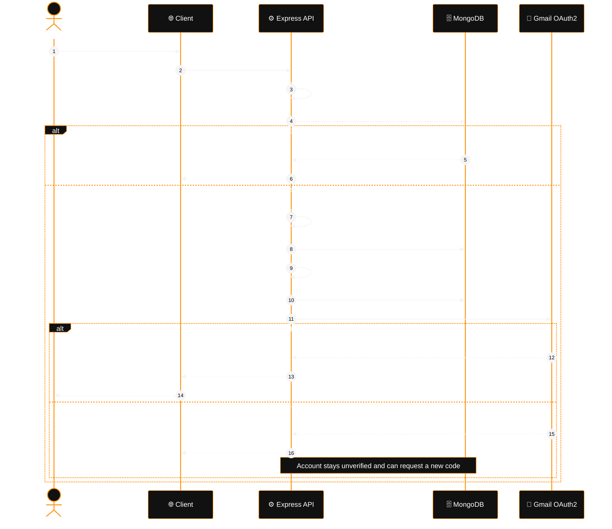

📨 **Request:** `username`, `email`, `password` &nbsp;·&nbsp; ✅ **Success:** `201 Created`

---

### 2️⃣ Verify email · `POST /verify-email`

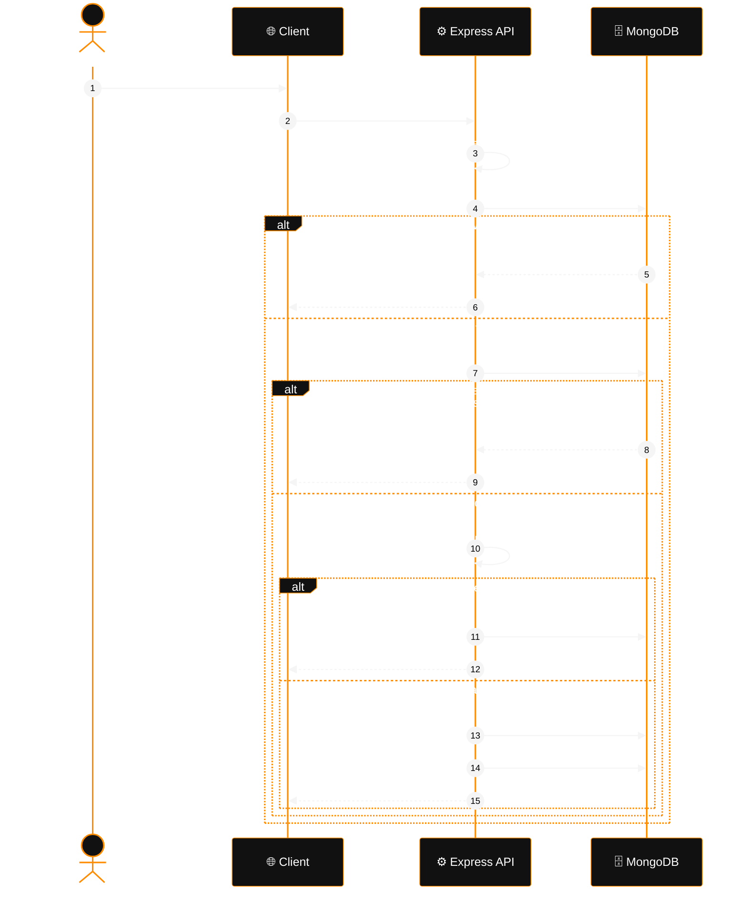

📨 **Request:** `email`, `otp` &nbsp;·&nbsp; ✅ **Success:** `200 OK`

---

### 3️⃣ Resend verification · `POST /resend-verification`

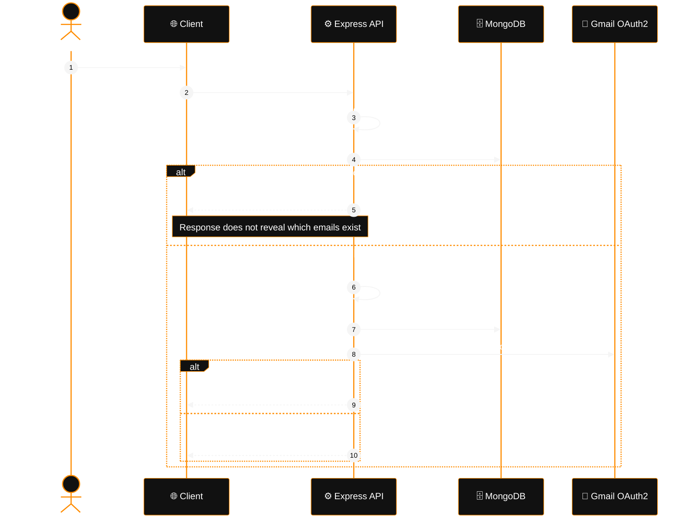

📨 **Request:** `email` only &nbsp;·&nbsp; ✅ **Success:** `200 OK`

---

### 4️⃣ Login · `POST /login`

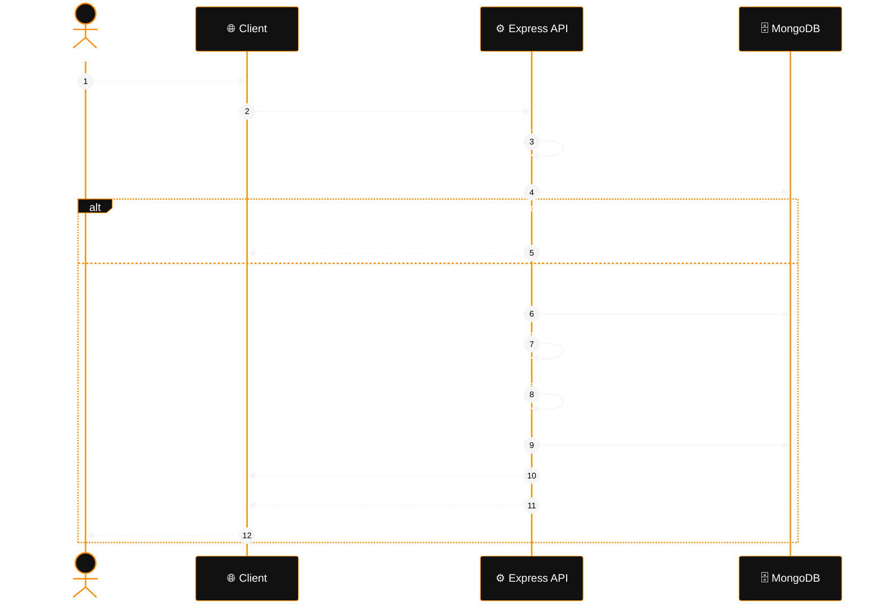

📨 **Request:** `email`, `password` &nbsp;·&nbsp; ✅ **Success:** `200 OK` + refresh cookie

---

### 5️⃣ Get current user · `GET /get-me`

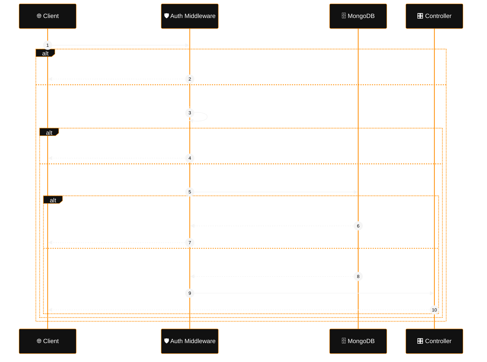

📨 **Needs:** `Authorization: Bearer <accessToken>` &nbsp;·&nbsp; ✅ **Success:** `200 OK`

---

### 6️⃣ Refresh token · `POST /refresh-token`

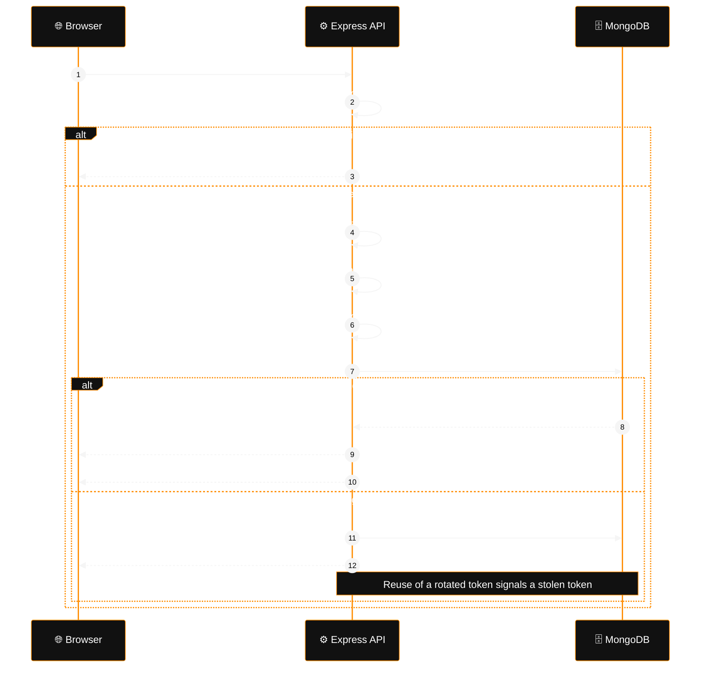

📨 **Needs:** refresh cookie &nbsp;·&nbsp; ✅ **Success:** `200 OK` + new refresh cookie

> [!WARNING]
> Do not send refresh requests from several tabs at the same time. If two requests use the same old token, the second is treated as reuse and the session is revoked. Coordinate refreshes in the frontend, for example with one shared promise.

---

### 7️⃣ Logout · `POST /logout`

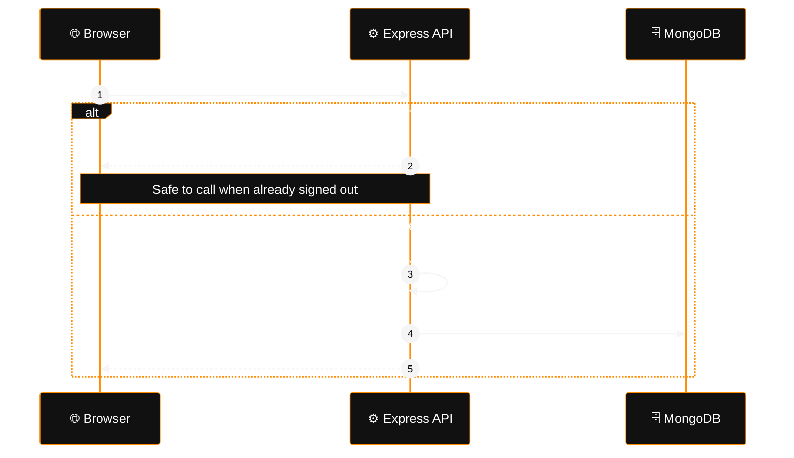

📨 **Needs:** refresh cookie, if present &nbsp;·&nbsp; ✅ **Success:** `200 OK` (idempotent)

---

### 8️⃣ Logout all · `POST /logout-all`

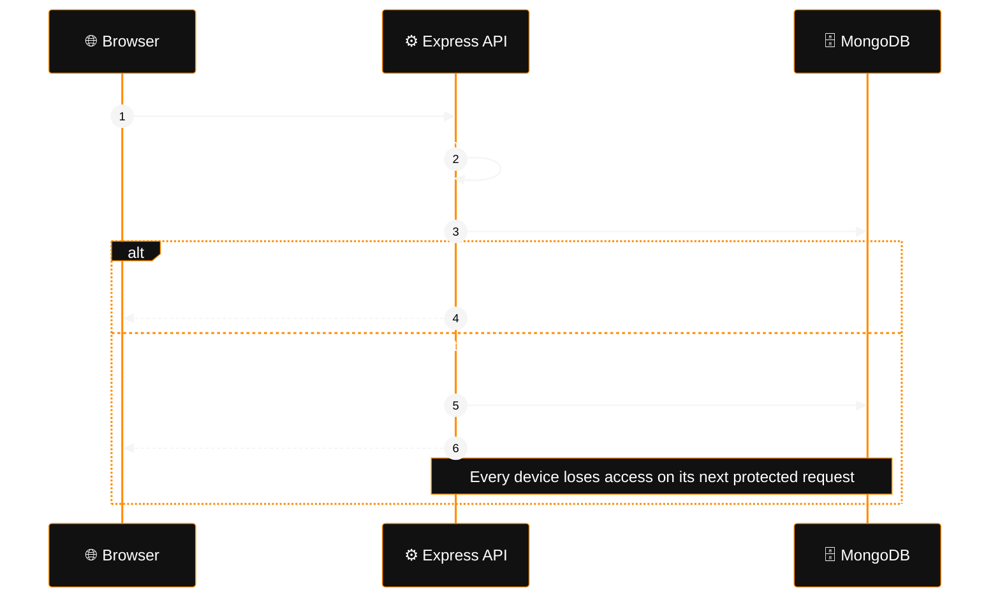

📨 **Needs:** refresh cookie &nbsp;·&nbsp; ✅ **Success:** `200 OK`

---

## 🔁 Lifecycle States

### 🧾 Session

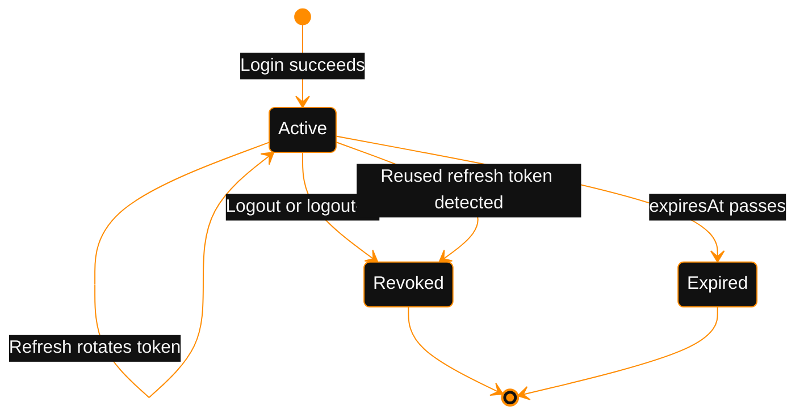

### 🔢 Email verification code

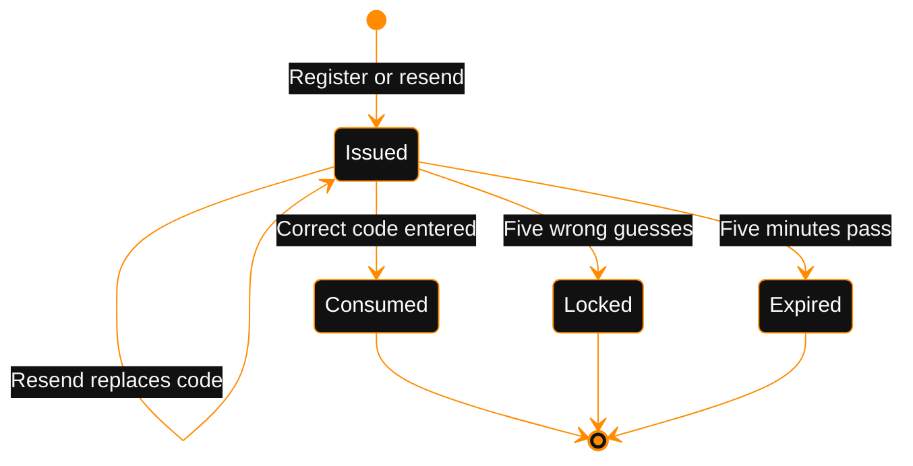

---

## 🗄️ Data Model

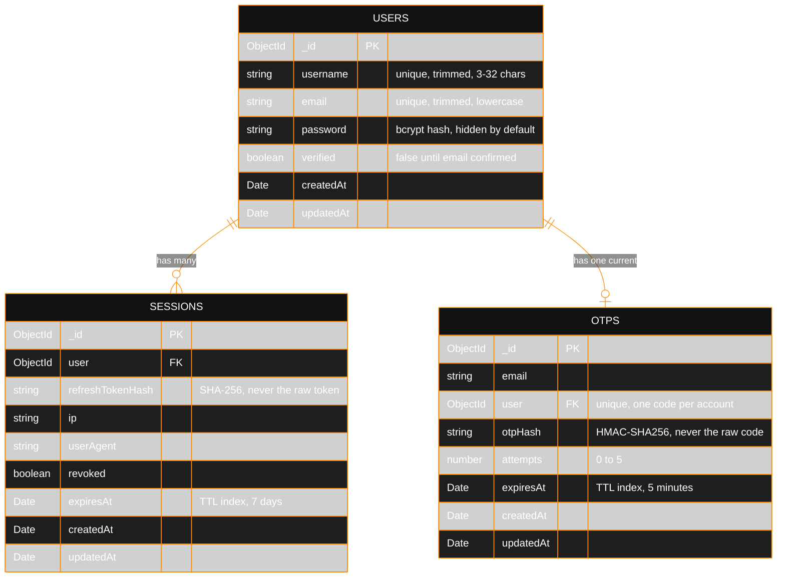

> [!NOTE]
> MongoDB's TTL cleanup runs in the background and may be slow to remove old records. The API checks `expiresAt` itself, so an expired record that is still in the database is treated as expired.

---

## 📁 Folder Structure

<details>
<summary><b>📂 Click to expand the full tree</b></summary>

```text
Auth Project/
├── .env                          # local settings (keep private)
├── .gitignore
├── README.md
├── banner.png
├── package.json
├── package-lock.json
├── LICENSE                       # MIT License
├── vitest.config.js             # Vitest settings
├── server.js                     # connects to DB, then starts HTTP server
├── src/
│   ├── app.js                    # Express app and middleware pipeline
│   ├── config/
│   │   ├── config.js             # loads and validates environment
│   │   └── database.js           # Mongoose connection
│   ├── controllers/
│   │   └── auth.controller.js    # reads requests, sets cookies, builds responses
│   ├── middlewares/
│   │   ├── auth.middleware.js    # access token and session check
│   │   ├── authLimiters.js       # per-IP rate limits
│   │   ├── error.middleware.js   # errors to JSON responses
│   │   └── origin.middleware.js  # CORS and origin allow list
│   ├── models/
│   │   ├── otp.model.js          # one-time email codes
│   │   ├── session.model.js      # per-device sessions
│   │   └── user.model.js         # accounts and password hashing
│   ├── routes/
│   │   └── auth.routes.js        # URL + method to controller
│   ├── services/
│   │   ├── auth.service.js       # registration, codes, login steps
│   │   └── email.service.js      # Gmail OAuth2 and Nodemailer
│   └── utils/
│       ├── apiError.js           # expected error with status code
│       ├── asyncHandler.js       # forwards async errors to Express
│       ├── authCookies.js        # one cookie config for set, rotate, clear
│       ├── authValidation.js     # input normalization and validation
│       ├── tokens.js             # access and refresh JWTs
│       └── utils.js              # code generation, hashing, email HTML
└── test/
    ├── authIntegration.test.js   # HTTP + in-memory MongoDB flow tests
    ├── authLimiters.test.js
    ├── authTokens.test.js
    ├── authValidation.test.js
    ├── originMiddleware.test.js
    └── setup.js                  # safe test-only environment values
```

</details>

### 🧭 What each part does

| File or folder | Responsibility |
|---|---|
| `server.js` | Connects to MongoDB first, then starts the HTTP server |
| `src/app.js` | Installs parsing, logging, cookies, origin checks, routes, 404, and errors |
| `src/config/config.js` | Loads `.env`, checks required values, requires a 32+ byte JWT secret, validates the port and `CLIENT_ORIGIN` |
| `src/routes/auth.routes.js` | Maps URL and method to a controller and applies rate limits |
| `src/controllers/auth.controller.js` | Reads requests, calls services and models, sets cookies, builds responses |
| `src/services/auth.service.js` | Registration, code delivery, resend, and login work |
| `src/services/email.service.js` | Gmail OAuth2 setup and verification email sending |
| `src/middlewares/auth.middleware.js` | Verifies access tokens and checks that their sessions are active |
| `src/middlewares/origin.middleware.js` | Allows the configured origin, handles preflight, rejects other browser origins |
| `src/middlewares/error.middleware.js` | Converts app, database, JSON-body, and token errors to JSON |
| `src/models/*.model.js` | Schemas for users, one-time codes, and sessions |
| `src/utils/tokens.js` | Creates and verifies access and refresh JWTs with separate purposes |
| `src/utils/authCookies.js` | Keeps refresh-cookie options identical when setting, rotating, and clearing |
| `test/` | Unit tests for validation, token purposes, rate limits, and origins |
| `test/authIntegration.test.js` | Exercises real HTTP routes with an isolated MongoDB and a mocked email sender |
| `vitest.config.js` | Configures Vitest to run the project tests in Node.js |
| `test/setup.js` | Supplies fake environment settings so tests never use production credentials |

---

## 🧩 Key Code Snippets

### ✅ Validate and normalize before touching the database

```js
// src/services/auth.service.js
const { username, email, password } = validateRegistrationInput(input);

const existingUser = await userModel.findOne({
  $or: [{ username }, { email }],
});
```

> Malformed values are rejected early, and email casing stays consistent.

---

### 🔢 Generate a code and store only a keyed hash

```js
// src/utils/utils.js
export function generateOTP() {
  return crypto.randomInt(100000, 1000000).toString();
}

export function hashOTP(otp) {
  return crypto
    .createHmac("sha256", config.JWT_SECRET)
    .update(otp)
    .digest("hex");
}
```

> `crypto.randomInt` is cryptographically secure. The database holds only the HMAC, so a leaked record does not reveal a usable code.

---

### 🎫 Separate token purposes

```js
// src/utils/tokens.js
{ sessionId: String(sessionId), tokenUse: "access"  } // lifetime: 15 minutes
{ sessionId: String(sessionId), tokenUse: "refresh" } // lifetime: 7 days
```

> Both tokens use HS256 with an issuer and audience. Checking `tokenUse` stops a refresh token from being accepted as an access token, and the reverse.

---

### 🛡️ Check the bearer token and the session

```js
// src/middlewares/auth.middleware.js
const match = authorization?.match(/^Bearer\s+(\S+)$/i);
if (!match) {
  throw new ApiError(401, "A bearer access token is required");
}

const { userId, sessionId } = verifyAccessToken(match[1]);

const session = await sessionModel.findOne({
  _id: sessionId,
  user: userId,
  revoked: false,
  expiresAt: { $gt: new Date() },
});
```

> A valid signature alone is not enough. The session must exist, belong to the user, and be neither revoked nor expired.

---

### 🔄 Rotate refresh tokens atomically

```js
// Conceptual pattern used during POST /refresh-token
const updated = await sessionModel.updateOne(
  {
    _id: sessionId,
    revoked: false,
    refreshTokenHash: oldHash,   // only matches if the old token is still current
  },
  { $set: { refreshTokenHash: newHash } },
);

if (updated.matchedCount === 0) {
  await sessionModel.updateOne({ _id: sessionId }, { $set: { revoked: true } });
  throw new ApiError(401, "Refresh token has already been used");
}
```

> The conditional update is the reuse check. If two requests race with the same old token, only one can match.

---

## 📚 API Reference

Base URL when running locally: **`http://localhost:3000/api/auth`**

| Method | Path | Purpose | Needs | Success |
|---|---|---|---|---|
| `POST` | `/register` | Create account and email a code | JSON body | `201` |
| `POST` | `/verify-email` | Verify email and consume the code | JSON body | `200` |
| `POST` | `/resend-verification` | Send a replacement code | JSON body | `200` |
| `POST` | `/login` | Check password and create a session | JSON body | `200` |
| `GET` | `/get-me` | Return the signed-in user's details | Bearer access token | `200` |
| `POST` | `/refresh-token` | Rotate refresh token, issue new access token | Refresh cookie | `200` |
| `POST` | `/logout` | Revoke current session and clear cookie | Refresh cookie, optional | `200` |
| `POST` | `/logout-all` | Revoke all active sessions | Refresh cookie | `200` |

> [!TIP]
> `/logout` is idempotent. If no refresh cookie is present, it still clears the cookie and returns success.
>
> `/resend-verification` returns the same message whether or not a new code was needed, so it does not reveal which emails are registered.

### 📦 Request bodies

<details>
<summary><b>Register</b></summary>

```json
{
  "username": "sample-user",
  "email": "person@example.com",
  "password": "a-long-example-passphrase"
}
```

</details>

<details>
<summary><b>Verify email</b></summary>

```json
{
  "email": "person@example.com",
  "otp": "123456"
}
```

</details>

<details>
<summary><b>Resend verification</b></summary>

```json
{
  "email": "person@example.com"
}
```

</details>

<details>
<summary><b>Login</b></summary>

```json
{
  "email": "person@example.com",
  "password": "a-long-example-passphrase"
}
```

</details>

### 📬 Response shapes

<details>
<summary><b>201 Created · register</b></summary>

```json
{
  "success": true,
  "message": "User registered successfully",
  "user": {
    "id": "<user-id>",
    "username": "sample-user",
    "email": "person@example.com",
    "verified": false
  }
}
```

</details>

<details>
<summary><b>200 OK · login</b></summary>

The refresh token is **not** in the body. It arrives as an `HttpOnly` cookie.

```json
{
  "success": true,
  "message": "Logged in successfully",
  "user": {
    "username": "sample-user",
    "email": "person@example.com"
  },
  "accessToken": "<short-lived-access-token>"
}
```

</details>

<details>
<summary><b>Error · every route</b></summary>

```json
{
  "success": false,
  "message": "Invalid or expired token"
}
```

</details>

### 🚦 Status codes

| Status | Meaning in this API |
|---|---|
| `400` | Invalid email, password, username, or code format |
| `401` | Missing, invalid, or expired authentication; wrong login credentials |
| `403` | Browser origin not allowed |
| `404` | Unknown route or user |
| `409` | Duplicate username or email |
| `413` | JSON body larger than 16 KB |
| `429` | Rate limit exceeded |
| `502` | Email service failed; account stays unverified and can request a new code |
| `500` | Unexpected server or database error (details are logged, not returned) |

---

## 🌍 Calling the API from a Frontend

The browser must send credentials so it can store and send the refresh cookie. For cross-origin frontends, the origin must match `CLIENT_ORIGIN`.

```js
const api = "http://localhost:3000/api/auth";

async function postJson(path, body) {
  const response = await fetch(`${api}${path}`, {
    method: "POST",
    credentials: "include",
    headers: { "Content-Type": "application/json" },
    body: JSON.stringify(body),
  });
  const data = await response.json();

  if (!response.ok) {
    throw new Error(data.message);
  }

  return data;
}

// 1. Register
await postJson("/register", {
  username: "sample-user",
  email: "person@example.com",
  password: "a-long-example-passphrase",
});

// 2. Verify the code from the email
const codeFromEmail = window.prompt("Enter the code sent to your email");
await postJson("/verify-email", {
  email: "person@example.com",
  otp: codeFromEmail,
});

// 3. Log in
const { accessToken } = await postJson("/login", {
  email: "person@example.com",
  password: "a-long-example-passphrase",
});

// 4. Call a protected route
const profile = await fetch(`${api}/get-me`, {
  credentials: "include",
  headers: { Authorization: `Bearer ${accessToken}` },
});

console.log(await profile.json());
```

> [!TIP]
> Keep the access token in memory where practical. The refresh token is `HttpOnly`, so JavaScript cannot read it. The browser sends it automatically on refresh and logout.

### 🔁 Refresh and sign out

```js
// Get a new access token
const refreshed = await fetch(`${api}/refresh-token`, {
  method: "POST",
  credentials: "include",
});
const { accessToken: newAccessToken } = await refreshed.json();

// Sign out this device
await fetch(`${api}/logout`, {
  method: "POST",
  credentials: "include",
});
```

Use `POST /logout-all` to revoke every active session.

> [!CAUTION]
> The old `GET /logout` and `GET /logoutAll` routes have been removed. State-changing actions must use `POST`.

---

## 🚦 Request Limits

Limits are per IP address and stored in memory.

| Endpoint group | Limit |
|---|---|
| Registration | 5 requests / hour |
| Login | 10 requests / 15 minutes |
| Verify email | 10 requests / 15 minutes, plus 5 guesses per code |
| Resend verification | 3 requests / hour |
| Refresh token | 30 requests / 15 minutes |

> [!NOTE]
> With more than one server instance, add a shared rate-limit store (for example, Redis) so all instances share the same counters.

---

## ⚙️ Setup

### Requirements

- Node.js compatible with the project's Express and Mongoose versions
- A MongoDB connection string
- Gmail OAuth2 credentials for sending email

### Install and run

```powershell
npm install
npm run dev     # development, uses nodemon server.js
npm start       # production
```

### Environment variables

Create `.env` in the project root. Never commit real credentials.

```dotenv
PORT_NO=3000
MONGO_URI=<MongoDB connection string>
JWT_SECRET=<at least 32 random bytes>
GOOGLE_CLIENT_ID=<OAuth client ID>
GOOGLE_CLIENT_SECRET=<OAuth client secret>
GOOGLE_REFRESH_TOKEN=<OAuth refresh token>
GOOGLE_USER=<sender email address>
CLIENT_ORIGIN=http://localhost:5173
```

| Variable | Required | Notes |
|---|:---:|---|
| `PORT_NO` | ❌ | Defaults to `3000` |
| `MONGO_URI` | ✅ | Checked at startup |
| `JWT_SECRET` | ✅ | At least 32 bytes |
| `GOOGLE_CLIENT_ID`, `GOOGLE_CLIENT_SECRET`, `GOOGLE_REFRESH_TOKEN`, `GOOGLE_USER` | ✅ | Gmail OAuth2 for sending email |
| `CLIENT_ORIGIN` | ❌ | Exact scheme, host, and port of a separate frontend, with no path |

Generate a strong secret:

```powershell
node -e "console.log(require('node:crypto').randomBytes(32).toString('hex'))"
```

> [!WARNING]
> In production, use HTTPS and set `NODE_ENV=production` so the refresh cookie is marked `Secure`. The cookie uses `SameSite=Strict`, so keep the frontend and API on the same site. Do not weaken this without a tested CSRF plan.

---

## 🧪 Testing

This project uses **Vitest** as its test runner. Unit tests use fake environment values. Integration tests run the Express API against an isolated in-memory MongoDB and replace Gmail with a fake email sender, so they do not need a real database or send real email.

```powershell
# Run all tests once
npm test

# Keep Vitest running and rerun tests as files change
npm run test:watch
```

| Test file | Covers |
|---|---|
| `authValidation.test.js` | Input normalization and validation |
| `authTokens.test.js` | Token purposes and separation |
| `authLimiters.test.js` | Rate-limit behavior |
| `originMiddleware.test.js` | Allowed and rejected origins |
| `authIntegration.test.js` | Registration, verification, login, protected profile, refresh rotation, logout, and logout-all |

### Latest test results

The complete suite passed: **5 test files and 15 tests** (`npm test`). This includes the HTTP integration tests using the in-memory MongoDB.

> [!NOTE]
> The in-memory MongoDB is for testing only. It starts locally for the test run and does not use or modify your configured database.

---

## 📄 License

This project is released under the **MIT License**. You may use, copy, modify, merge, publish, distribute, sublicense, and sell copies, provided you include the copyright and permission notice. The software is provided without warranty. See the [LICENSE](./LICENSE) file for the complete terms.

---

## 🧱 Known Limits and Roadmap

- ⚠️ **Rate limits are in memory.** Multiple instances need a shared store.
- ⚠️ **One frontend origin is supported.** Set `CLIENT_ORIGIN` correctly if the frontend is separate or a reverse proxy changes the visible scheme or host.
- ⚠️ **Old tokens are rejected** after the token-format update, so users must sign in again.
- ⚠️ **Sessions without `expiresAt`** no longer authorize requests.
- ⚠️ **OTP unique index:** before creating the unique index on `user` in an existing database, remove duplicate OTP documents per user.
- 🗒️ **Logging** is plain console output. Production should use structured, redacted logs with request IDs.
- 🧱 **Hardening still to do:** security headers and a shared rate-limit store.
- 🚧 **Not implemented yet:** password reset, password change, account deletion, and a device or session management page.

---

<p align="center">
  <br/><br/>
  <sub>© Auth Project by <b>Samroz Burhan</b> · Built with Node.js, Express, and MongoDB</sub>
</p>
