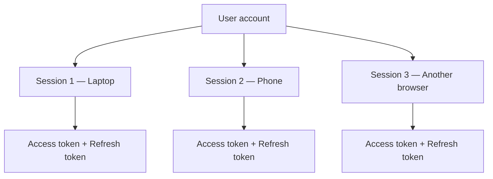
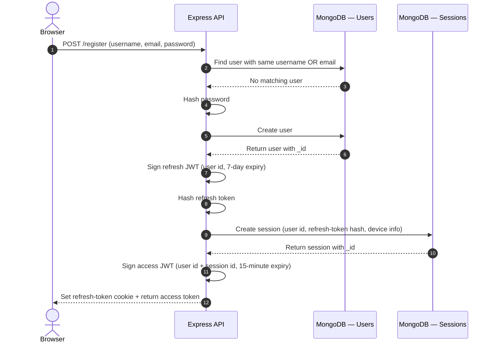
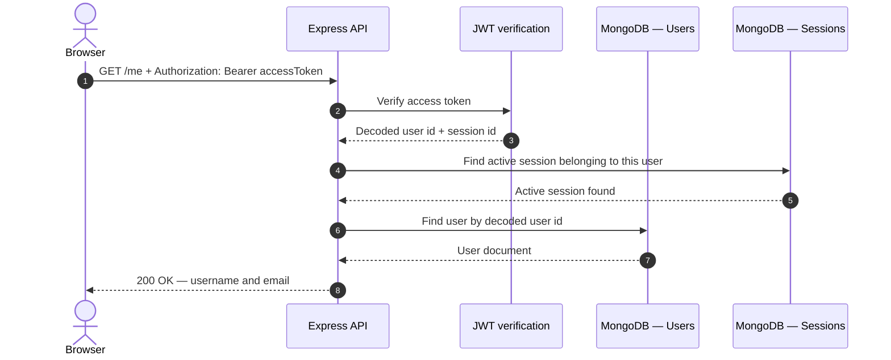
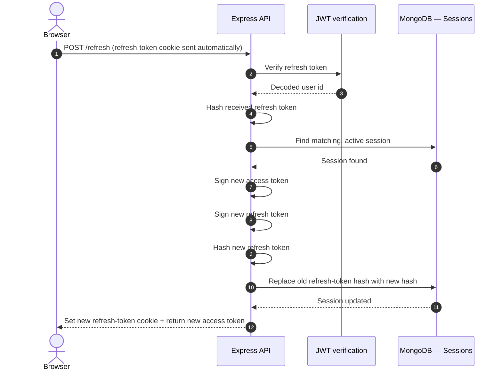
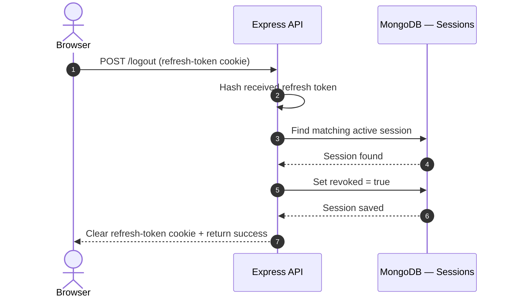
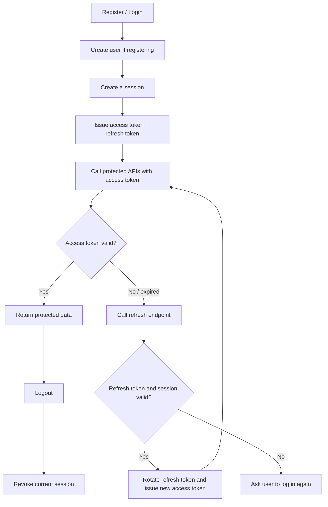

# JWT Authentication — Sequence Diagram & Walkthrough

This document explains the authentication flow in a Node.js, Express, and MongoDB application using:

- **User** — the account stored in MongoDB.
- **Session** — one particular login, usually associated with a browser or device.
- **Access token** — a short-lived JWT sent with protected API requests.
- **Refresh token** — a longer-lived JWT stored in an HTTP-only cookie and used to obtain new tokens.

The diagrams distinguish between what the current controller does and the checks that should be added for a safer implementation.

---

## 1. Big picture

A user can have multiple sessions. For example, logging in on a laptop and a phone creates two separate sessions for the same user.

**Important:** A session is not the same thing as a user. The user is the account; each session represents one login.

---

## 2. Register / first login

When a user registers, the server creates the account and then creates a session for that login.

### What is happening?

1. The browser sends the registration details.
2. The server checks whether the username or email is already in use.
3. The server hashes the password and saves the new user.
4. The server creates a refresh token for that user.
5. The server hashes the refresh token and stores the hash in a new session document.
6. The server creates an access token containing the user's ID and this session's ID.
7. The server sends the access token in the response and the refresh token in a cookie.

**Why save a hash of the refresh token?** If someone gets a copy of your database, they should not be able to directly use the stored refresh-token value. The server hashes the token received from the browser and compares that hash with the stored hash.

> Passwords should be hashed with a password-hashing algorithm such as Argon2 or bcrypt. A fast SHA-256 hash is not suitable for password storage.

---

## 3. Access a protected route — `GET /me`

The access token proves which user is making the request. It should also identify the session that made the request.

### What is happening?

1. The browser sends the access token in the `Authorization` header.
2. The server verifies the JWT signature and expiry.
3. The decoded token gives the server the user ID and session ID.
4. The server checks that the session still exists, belongs to that user, and has not been revoked.
5. The server finds the user and returns the requested information.

**Important difference in your current code:** Your current `getMe` verifies the access token and finds the user, but it does not check the session ID or whether the session has been revoked. The session check shown above is a recommended addition, not something your current controller already does.

---

## 4. Refresh tokens — when the access token expires

The access token is short-lived. When it expires, the browser can use the refresh token cookie to request a new access token without asking the user to log in again.

### What is token rotation?

Imagine the session currently stores the hash of refresh token **R1**.

- The browser sends **R1** to the refresh endpoint.
- The server verifies R1 and checks its hash against the session.
- The server creates a new refresh token, **R2**.
- The server replaces the stored hash of R1 with the hash of R2.
- The browser receives R2 in the updated cookie.

After rotation, R1 should no longer work because its hash is no longer stored in the session.

### Does refresh create a new session?

**No.** In this design, refresh updates the existing session document. The user is still logged in from the same device/browser. A new session is normally created when the user logs in from another device or browser.

**Important difference in your current code:** Your refresh controller updates the existing session's refresh-token hash, which is correct for this design. Make sure the new access token also includes the session ID, and verify that the matched session belongs to the user ID in the refresh JWT.

---

## 5. Logout

Logout revokes the current session so its refresh token can no longer be used.

### What is happening?

1. The browser sends its refresh-token cookie.
2. The server hashes the token and finds the matching active session.
3. The server marks that session as revoked.
4. The server clears the cookie in the browser.

The user can still have other active sessions. For example, logging out on a laptop does not automatically log them out on their phone.

**Access-token note:** Revoking a session does not automatically invalidate an already-issued JWT. If protected routes only verify the JWT, that access token can remain usable until it expires. Checking the session's revoked status on protected requests prevents that.

---

## 6. How the four flows fit together

---

## 7. Quick comparison

| Item | Purpose | Typical lifetime | Where it is kept |
|---|---|---:|---|
| User | Represents the account | Until account deletion | MongoDB users collection |
| Session | Represents one login/device | Until expiry or revocation | MongoDB sessions collection |
| Access token | Access protected APIs | 15 minutes in this project | Usually held by the frontend and sent in the Authorization header |
| Refresh token | Obtain a new token pair | 7 days in this project | HTTP-only cookie; only its hash is stored in the database |

---

## 8. Important implementation checks

Before treating the authentication system as production-ready, check these points:

- [ ] Fix the cookie option typo: use `httpOnly`, not `httyOnly`.
- [ ] Hash passwords with bcrypt or Argon2, not plain SHA-256.
- [ ] Include both `userId` and `sessionId` in access tokens.
- [ ] In `GET /me` and other protected routes, check that the session exists, belongs to the user, and is not revoked.
- [ ] During refresh, verify that the matched session belongs to the user ID in the refresh token.
- [ ] When rotating refresh tokens, replace the stored hash and reject the old token.
- [ ] Clear the cookie using matching cookie options (especially path and same-site settings).
- [ ] Consider refresh-token reuse detection and appropriate handling if an old, already-rotated token is presented.

---

## 9. The simplest way to remember it

- **Register/Login:** Create a session and issue tokens.
- **Access token:** Use it to enter protected routes.
- **Refresh token:** Use it to get a fresh access token when the old one expires.
- **Refresh rotation:** Replace the old refresh token with a new one in the same session.
- **Logout:** Revoke that session.

**One user can have many sessions. Each session has its own token pair.**
