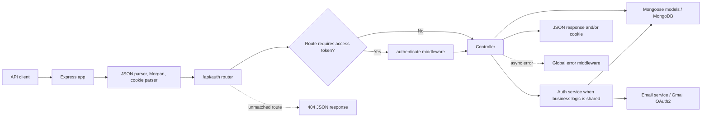
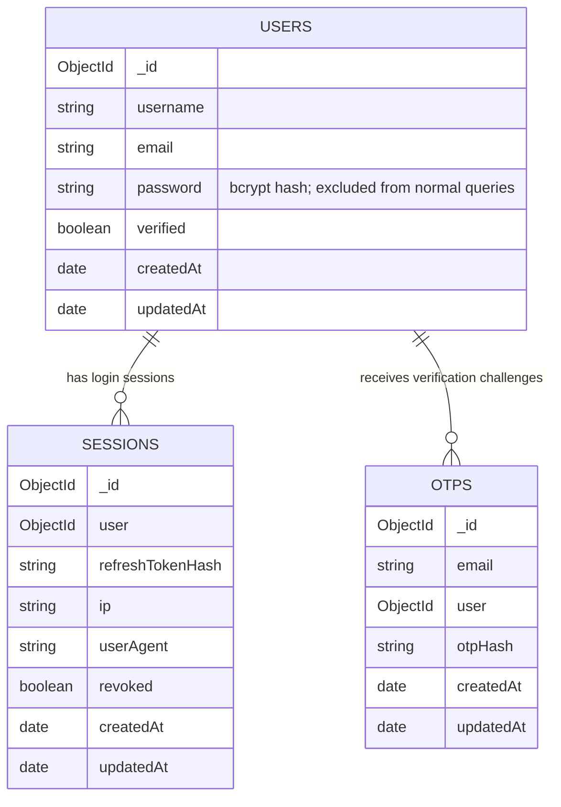
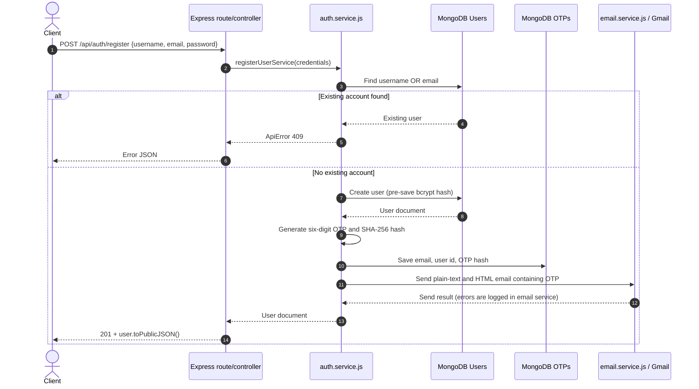
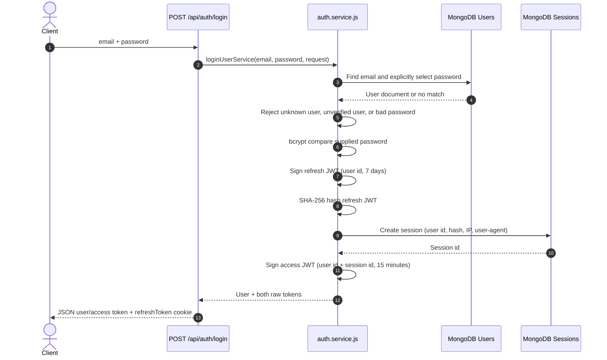
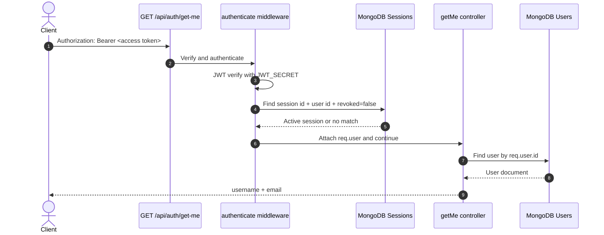
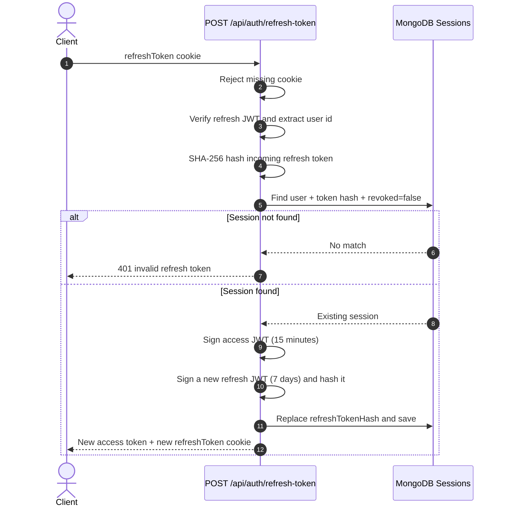
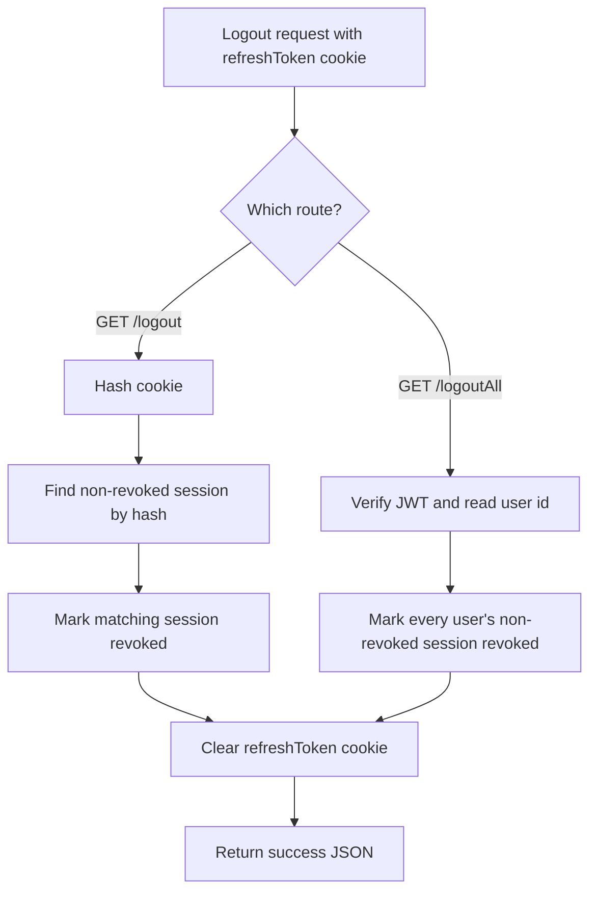

# Authentication System Backend

A Node.js authentication API built with Express, MongoDB, and Mongoose. It supports account registration, email OTP verification, password login, per-login sessions, short-lived JWT access tokens, rotating refresh tokens, and session logout.

This document describes what the code currently does, how a request moves through the application, and where each responsibility lives. Flow diagrams are written in Mermaid so they can be used as a starting point for architecture charts.

> **Code accuracy:** The flows below describe the current implementation, not an idealized authentication design. The final section calls out implementation details that affect whether some flows work as expected.

## 1. Technology and responsibilities

| Concern | Implementation |
|---|---|
| HTTP API | Express 5 |
| Persistence | MongoDB through Mongoose |
| Password storage | bcrypt, cost factor 12 |
| Access and refresh tokens | JWT, signed with `JWT_SECRET` |
| Refresh-token persistence | SHA-256 hash stored on a session document |
| Email verification | Six-digit OTP emailed with Nodemailer and Gmail OAuth2 |
| Request logging | Morgan (`dev` format) |
| Request body and cookies | Express JSON parser and `cookie-parser` |

## 2. Application map

```text
server.js
└── startup: load configuration, start MongoDB connection, listen for HTTP

src/
├── app.js
│   ├── JSON body parser, Morgan logger, cookie parser
│   ├── /api/auth routes
│   ├── 404 response
│   └── global error middleware
├── config/
│   ├── config.js             dotenv loading and required environment checks
│   └── database.js           Mongoose connection
├── routes/
│   └── auth.routes.js        URL-to-controller mapping; protects get-me
├── controllers/
│   └── auth.controller.js    HTTP input/output, cookies, token workflows
├── services/
│   ├── auth.service.js       registration and login business operations
│   └── email.service.js      Gmail OAuth2 transport and email sending
├── middlewares/
│   ├── auth.middleware.js    access-token and session validation
│   └── error.middleware.js   normalized error responses
├── models/
│   ├── user.model.js         account fields and password behavior
│   ├── otp.model.js          email verification challenge
│   └── session.model.js      one login/device session and refresh hash
└── utils/
    ├── apiError.js           application error with an HTTP status
    ├── asyncHandler.js       forwards async controller errors to Express
    └── utils.js              OTP generation and HTML email template
```

### Request handling at a glance



The app mounts the authentication router at `/api/auth`. Controllers generally run through `asyncHandler`, which forwards rejected promises to Express error handling. The 404 handler is registered before the global error handler; an unmatched URL returns the app's `Route not Found` response directly.

## 3. Startup and configuration

1. `server.js` imports the app, database connector, and configuration.
2. Importing `config.js` loads `.env` using `dotenv` and checks that every required variable is present.
3. `connectDB()` starts the Mongoose connection to `MONGO_URI`.
4. The Express app begins listening on `PORT_NO`, falling back to port `3000` only if that value is falsy.
5. Once requests arrive, `app.js` parses JSON, logs requests, parses cookies, and dispatches matching routes.

The required environment variable names are:

```dotenv
PORT_NO=3000
MONGO_URI=<your MongoDB connection string>
JWT_SECRET=<a long, private signing secret>
GOOGLE_CLIENT_ID=<OAuth client ID>
GOOGLE_CLIENT_SECRET=<OAuth client secret>
GOOGLE_REFRESH_TOKEN=<OAuth refresh token>
GOOGLE_USER=<Gmail account used to send verification emails>
```

These are names and placeholders only. Do not commit real credentials. The application currently requires the Gmail OAuth variables at startup, even if you are only testing routes that do not send email.

## 4. Data model and relationships



### User

`user.model.js` defines username, email, password, and `verified`. Username and email are required and unique; email is lowercased and username is trimmed. Password is excluded from query results unless explicitly selected. Before saving a changed password, the model hashes it with bcrypt using 12 rounds. The model also provides `comparePassword()` for login and `toPublicJSON()` so registration can return a limited user representation.

### OTP

An OTP document stores the user's email, a reference to the user, and the SHA-256 hash of the code. The raw OTP is sent by email and is not stored in the document.

### Session

A session represents one successful login, not the user account itself. It stores the user reference, SHA-256 hash of the current refresh token, request IP, user-agent string, and a `revoked` flag. Logging in on another device creates another session. Refreshing tokens updates the existing session's refresh-token hash.

## 5. Route catalogue

All paths are relative to `/api/auth`.

| Method and path | Access | Purpose | Main response |
|---|---|---|---|
| `POST /register` | Public | Create an unverified account, save an OTP hash, and send an OTP email | `201`, public user JSON |
| `POST /verify-email` | Public | Verify an account using the submitted email and OTP | `200`, verification message |
| `POST /login` | Public | Check verified account credentials, create a session, issue tokens | `200`, user and access token; refresh-token cookie |
| `GET /get-me` | Access token | Fetch username and email for the authenticated user | `200`, user fields |
| `POST /refresh-token` | Refresh-token cookie | Validate and rotate the refresh token; issue a fresh access token | `200`, access token; updated cookie |
| `GET /logout` | Refresh-token cookie | Revoke the session matching the refresh-token hash | `200`, logout message; clear cookie |
| `GET /logoutAll` | Refresh-token cookie | Revoke all sessions for the user identified by the refresh JWT | `200`, logout message; clear cookie |

The route declarations are in `src/routes/auth.routes.js`. Only `GET /get-me` is attached to the `authenticate` access-token middleware in that router.

### Input shapes used by the controllers

```json
// POST /api/auth/register
{
  "username": "sample-user",
  "email": "user@example.com",
  "password": "your-password"
}
```

```json
// POST /api/auth/verify-email
{
  "email": "user@example.com",
  "otp": "123456"
}
```

```json
// POST /api/auth/login
{
  "email": "user@example.com",
  "password": "your-password"
}
```

For `/get-me`, the client is expected to send an access token in the `Authorization: Bearer <access-token>` header. Refresh and logout routes read the `refreshToken` cookie.

## 6. Registration and email verification flow

Registration creates the user and initiates verification; it does **not** create a login session or issue tokens.



### Step-by-step

1. `registerUser` reads `username`, `email`, and `password` from `req.body`.
2. `registerUserService` searches for a user matching either username or email. A match raises `ApiError(409)`.
3. The service creates a user. The user model's save hook hashes the password before MongoDB stores it.
4. `generateOTP()` creates a six-digit decimal string. `getOTPHtml()` builds the email HTML.
5. The service hashes the OTP with SHA-256 and stores the hash in an OTP document.
6. `sendEmail()` sends the raw OTP in the text and HTML message using the configured Gmail OAuth2 transporter.
7. The controller responds with `user.toPublicJSON()`, containing the ID, username, email, and verification state; it does not return the password or OTP.
8. The client submits the OTP and email to `/verify-email`. The controller hashes the supplied OTP and searches for a matching email/hash pair.
9. If found, the controller sets the referenced user's `verified` field to `true`, deletes OTP documents for that user, and returns success.
10. Login is allowed only after the account's `verified` flag is true.

## 7. Login and session creation



The refresh token has a seven-day expiry and contains the user ID. Its hash, rather than its raw value, is stored in the session. The access token has a fifteen-minute expiry and contains both user ID and session ID. Login returns the access token in JSON and sets the refresh token in an HTTP-only, secure, strict-same-site cookie.

The login controller returns only username and email as the user data. It does not expose the session document or refresh token in the JSON body.

## 8. Protected request flow

The intended path is to verify the access JWT, find its active session, attach the authenticated identity to the request, and then fetch the user.



The actual middleware checks that a session exists, belongs to the decoded user ID, and is not revoked. The identity it attaches to `req.user` and the bearer-token parsing have implementation issues; see [Implementation notes](#11-implementation-notes-and-flow-caveats) before treating this diagram as a successfully working request.

## 9. Refresh-token rotation



The refresh endpoint updates the matching session rather than creating a new one. Since the stored hash is replaced, the previously presented refresh token should no longer match that session. The response includes the new access token; the new refresh token is sent as a cookie.

## 10. Logout flows

### Current session: `GET /api/auth/logout`

1. Read the refresh token cookie; return an error if it is missing.
2. Hash the raw cookie value and find a non-revoked session with that hash.
3. Mark that session `revoked: true` and save it.
4. Clear the `refreshToken` cookie and return success.

This is a refresh-token-hash lookup. The controller does not verify the refresh JWT before doing that lookup.

### All sessions: `GET /api/auth/logoutAll`

1. Read and verify the refresh token JWT.
2. Use its user ID to update every matching non-revoked session to `revoked: true`.
3. Clear the refresh-token cookie and return success.

This revokes all session documents for the user, not just the current device. It does not check the current cookie's hash against a session before revoking.



## 11. Implementation notes and flow caveats

These are observations about the current code, included so diagrams and client expectations do not hide discrepancies:

1. **Bearer token extraction prevents the protected request from working as intended.** `authenticate` checks for a `Bearer` prefix, but then uses `authorization.split(" ")[0]`, which selects the text `Bearer` rather than the JWT. JWT verification will reject that value. It should select the token portion of the header.
2. **The authenticated user ID is set to the session ID.** The middleware assigns `req.user.id` from `session.id`, which identifies the session document. `getMe` then uses that value in `userModel.findById()`, which expects a user ID. Consequently, even after fixing token extraction, this lookup does not use the decoded user ID.
3. **The OTP email's stated five-minute expiry is not enforced by the current data flow.** The template says the code expires in five minutes, but verification only checks email and OTP hash. No expiry comparison or TTL index is configured on the OTP model.
4. **Email sending errors are logged and swallowed by `sendEmail()`.** The registration service awaits the function, but the mail service catches failures internally and does not rethrow. Registration can therefore return success even when the verification email was not sent.
5. **Cookie options differ between login and later operations.** Login sets `secure: true` and omits an explicit path. Refresh uses `secure` only in production and sets `path: "/api/auth"`; logout clears a cookie using the latter options. In local non-HTTPS development, the login cookie may not be stored by the browser. Cookie path/security consistency matters for refresh and clearing.
6. **Database connection and HTTP listening are not sequenced.** `server.js` calls `connectDB()` without awaiting it, then starts listening immediately. The HTTP server may accept requests before MongoDB is connected. `connectDB()` logs a failure but does not stop startup or rethrow the error.
7. **Registration is not an authenticated signup.** It returns the created unverified user but does not log the user in. The client must verify the email and then call `/login`.
8. **OTP generation uses `Math.random()`.** The current six-digit generator is `Math.floor(100000 + Math.random() * 900000)`. This is the implementation behavior; it is not a cryptographically secure random-number generator.

## 12. Error handling

Controllers wrapped with `asyncHandler` pass asynchronous errors to `error.middleware.js`. The global handler responds with a JSON object in this shape:

```json
{
  "success": false,
  "message": "Error message"
}
```

The handler maps application `ApiError` status codes, duplicate-key errors to `409`, Mongoose validation errors to `400`, invalid ObjectIds to `400`, and JWT errors to `401`. Unrecognized errors are logged and returned as `500 Internal Server Error`.

Common application-level errors include duplicate username/email (`409`), invalid credentials (`401`), unverified email (`403`), missing/invalid refresh token (`401` or `400`, depending on route), and invalid OTP (`400`).

## 13. Running locally

Requirements: a supported Node.js runtime, MongoDB access, and Gmail OAuth2 credentials for email delivery.

```powershell
npm install
# Create .env in the project root and fill in the required variables above.
npm run dev
```

`npm run dev` launches `nodemon server.js`. The configured `npm test` command is currently a placeholder that exits with “Error: no test specified”; it is not an implemented test suite.

## 14. Short version for a system diagram

```text
Register
  -> check username/email uniqueness
  -> create User (bcrypt password hash; verified=false)
  -> generate OTP -> hash -> store OTP record
  -> email raw OTP
  -> return public User

Verify email
  -> hash submitted OTP
  -> match email + OTP hash
  -> set User.verified=true
  -> delete that user's OTP records

Login
  -> load User including password hash
  -> require verified=true and bcrypt password match
  -> create refresh JWT -> store only its SHA-256 hash in Session
  -> create access JWT containing user id + session id
  -> return access JWT; set refresh JWT cookie

Protected request
  -> read Bearer access JWT
  -> verify JWT -> find active matching Session
  -> load User -> return user fields
  -> current middleware has parsing/identity issues noted above

Refresh
  -> verify refresh JWT
  -> hash it -> find active matching Session
  -> issue access JWT + new refresh JWT
  -> replace stored refresh hash

Logout
  -> revoke one session by refresh-token hash, or all sessions by JWT user id
  -> clear refreshToken cookie
```
