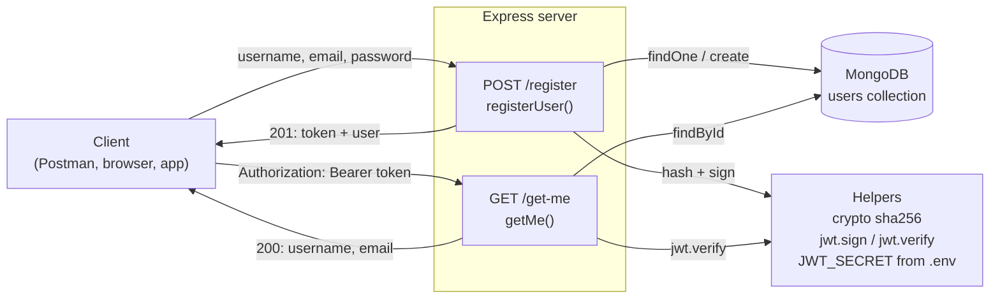
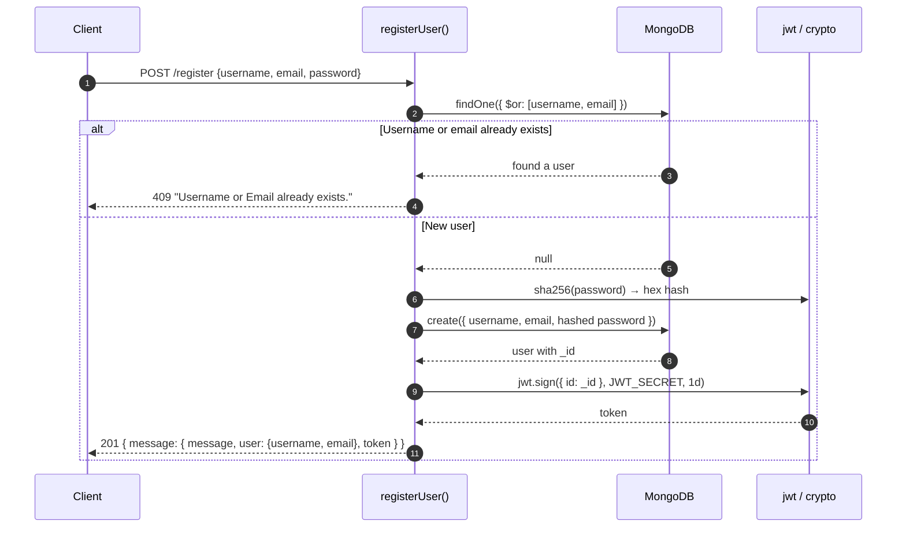
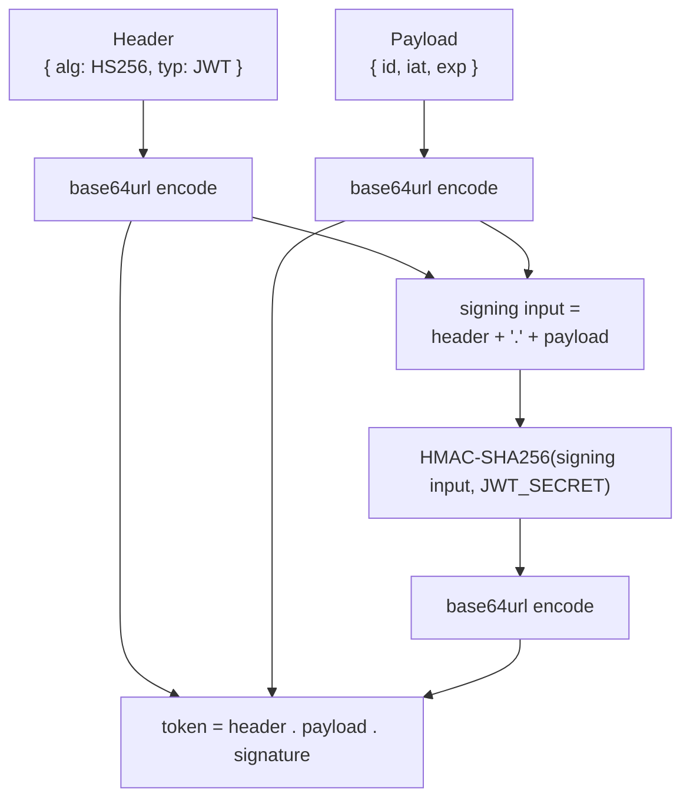
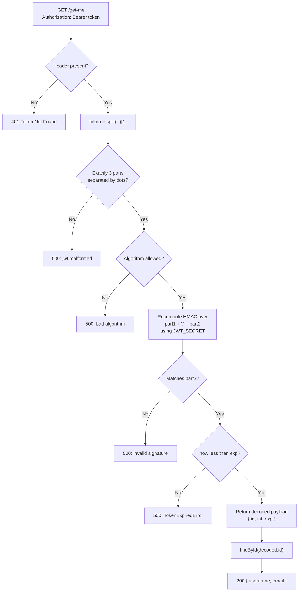
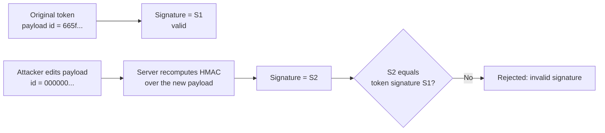
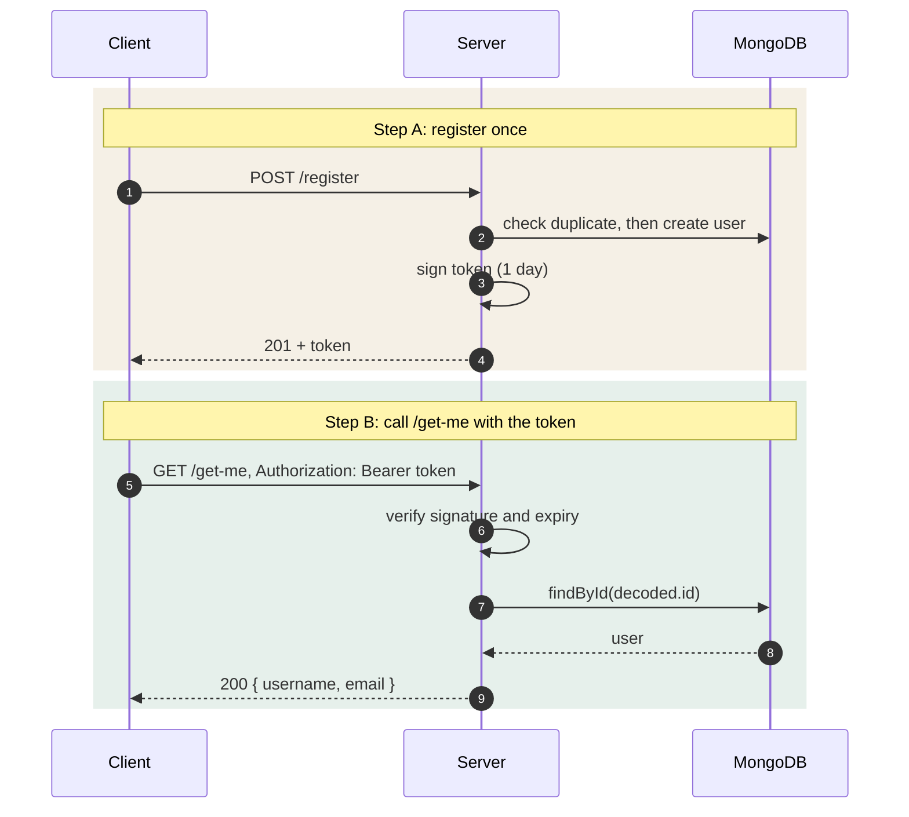

# Authentication: how Register, Token and /get-me Work

This section explains how a user signs up, gets a JWT, and proves who they are later.
Diagrams are Mermaid, so GitHub renders them directly.

---

## 1. The big picture



Two routes, one database, one secret. Register creates the token. `/get-me` checks it.

---

## 2. Register: step by step



Note: the password is never returned. Only the hash is stored.

---

## 3. Sign: how the token is built

The token has three parts joined by dots: `header.payload.signature`.



What `jwt.sign` adds for you:

| Field | Value |
|-------|-------|
| `id` | the user's `_id` (you pass this) |
| `iat` | issued-at time, Unix seconds (added automatically) |
| `exp` | `iat` + 86400 seconds, i.e. 1 day (from `expiresIn: "1d"`) |

---

## 4. Verify: how /get-me checks the token



Key rule: the payload is not trusted until the signature matches.

> **Current limitation:** this code has no try/catch around `jwt.verify`, so a bad or expired
> token returns a server error (500) instead of a clean 401. A null check after `findById` is
> also missing.

---

## 5. Tampering fails



Changing the payload changes the signing input, so the old signature no longer fits.
Forging a matching signature needs `JWT_SECRET`, which only the server has.

---

## 6. Full request life cycle



---

## 7. Test data

Run these in order in Postman or any HTTP client.

**Test 1: register**

```http
POST /register
Content-Type: application/json

{
  "username": "sam",
  "email": "sam@example.com",
  "password": "secret123"
}
```

Expect `201` with a `token`. Copy the token for the next tests.

**Test 2: check the token**

```http
GET /get-me
Authorization: Bearer <token from test 1>
```

Expect `200` with `username` and `email`.

| # | Request | Expected | Why |
|---|---------|----------|-----|
| 1 | POST /register (sam, sam@example.com, secret123) | 201 + token | Happy path |
| 2 | POST /register (sam, other@example.com, x) | 409 | Same username |
| 3 | POST /register (sam2, sam@example.com, x) | 409 | Same email |
| 4 | GET /get-me with token from test 1 | 200 | Valid signature and not expired |
| 5 | GET /get-me with no Authorization header | 401 "Token Not Found" | Stops before verify |
| 6 | GET /get-me with `Bearer abc.def.ghi` | 500 | Malformed or bad signature |
| 7 | GET /get-me with a token edited by one character | 500 | Signature does not match |
| 8 | GET /get-me with a token older than 1 day | 500 | TokenExpiredError |

**Database after test 1**

```json
{
  "_id": "665f1a2b3c4d5e6f7a8b9c0d",
  "username": "sam",
  "email": "sam@example.com",
  "password": "9f86d0...(sha256 of secret123, 64 hex chars)"
}
```

---

## 8. Facts to remember

- The JWT payload is **encoded, not encrypted**. Anyone holding the token can read it. Never put secrets in it.
- `/get-me` is **stateless** for the token: no database lookup is needed to check the signature. Only `findById` touches the database.
- A deleted user's token still passes the signature check. The `findById` lookup is what catches it.
- Changing `JWT_SECRET` invalidates every token already issued.
- Passwords are hashed with **unsalted sha256**. For production, use bcrypt or argon2.
