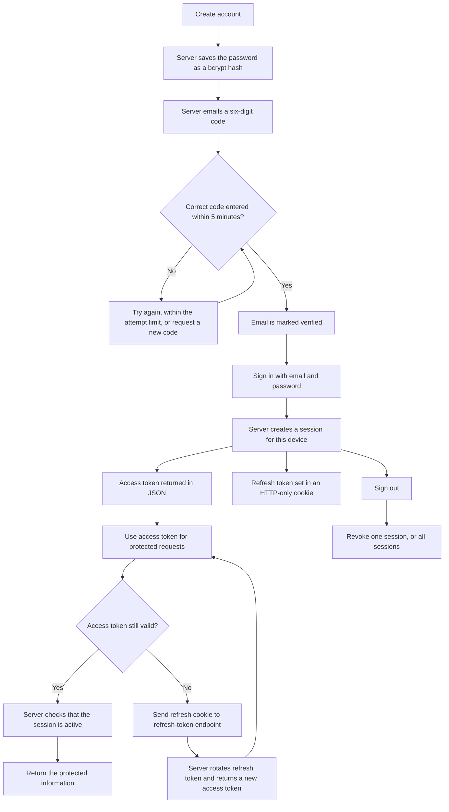
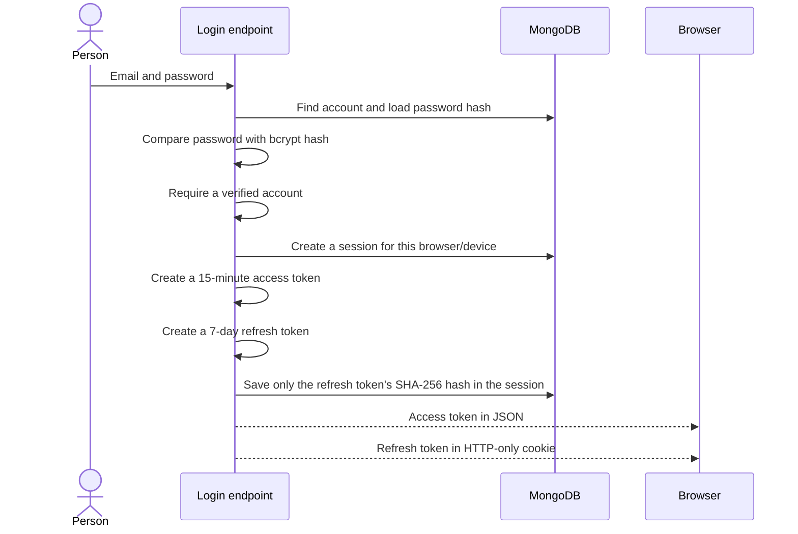
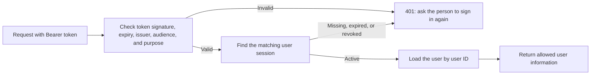
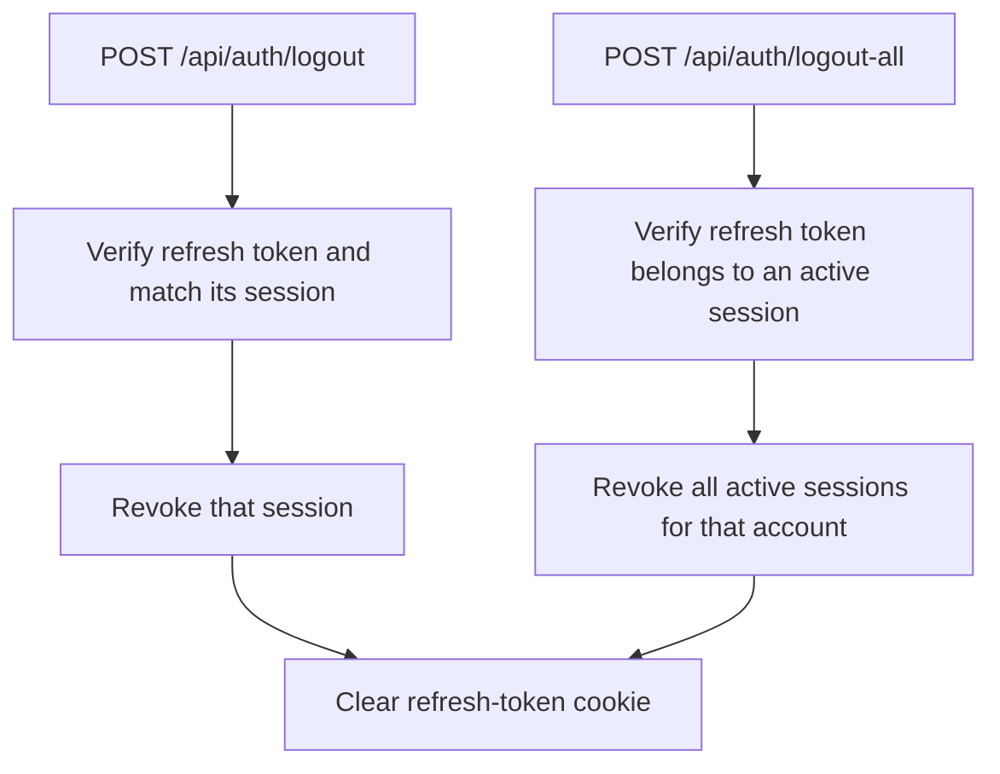

# Authentication Backend

A small API that lets people create an account, verify their email, sign in, and sign out. It is built with Node.js, Express, MongoDB, and Mongoose.

This guide uses everyday language and diagrams to show what happens behind the scenes. It describes the code as it works now.

## What the important words mean

| Word | Simple meaning |
|---|---|
| **User** | A person's account: username, email, and a protected password hash. |
| **Verification code (OTP)** | A short code sent by email to prove the user can receive mail at that address. |
| **Session** | One signed-in browser or device. One account can have several sessions. |
| **Access token** | A short-lived pass carried in the `Authorization` header when asking for protected information. |
| **Refresh token** | A longer-lived pass kept in an HTTP-only browser cookie. It gets a new access token when the old one expires. |

## The whole journey



## What happens during each step

### 1. Create an account and verify the email

```mermaid
sequenceDiagram
    actor Person
    participant API as Authentication API
    participant DB as MongoDB
    participant Mail as Email service

    Person->>API: Register: username, email, password
    API->>DB: Check username/email and save new account
    Note over DB: Password is converted to a bcrypt hash
    API->>API: Generate a random 6-digit code and keyed hash
    API->>DB: Save code hash, expiry time, and attempt counter
    API->>Mail: Email the code
    API-->>Person: Account created; please verify email
    Person->>API: Submit email and 6-digit code
    API->>DB: Check expiry, attempt limit, and code hash
    API->>DB: Remove the one-time code and mark account verified
    API-->>Person: Email verified
```

The raw verification code is emailed but is not saved in MongoDB. The database keeps a keyed hash instead. A code lasts five minutes, and only five attempts are allowed for that code. Requests are also rate-limited by IP. A new code replaces the previous one.

If the email provider cannot send the message, registration returns an error instead of claiming the email was sent. The account remains unverified, so the person can use **resend verification** to try again.

### 2. Sign in



Wrong passwords, unknown accounts, and unverified accounts receive the same sign-in error. A session records which account it belongs to, whether it has been revoked, and when it expires.

### 3. Use the access token

For a protected request, send the access token like this:

```http
Authorization: Bearer <access-token>
```



The token names both the user and the session. Checking the session means signing out can invalidate protected requests even if an access token has not reached its 15-minute expiry yet.

### 4. Refresh an expired access token

```mermaid
sequenceDiagram
    actor Browser
    participant API as Refresh endpoint
    participant DB as MongoDB

    Browser->>API: POST /api/auth/refresh-token (cookie sent automatically)
    API->>API: Verify this is a refresh token
    API->>DB: Atomically match old token hash and active session
    alt Token is current and session is active
        API->>DB: Replace old hash with new refresh-token hash
        API-->>Browser: New access token and new refresh-token cookie
    else Token is old, expired, or already used
        API->>DB: Revoke session if this was a previously rotated token
        API-->>Browser: 401; sign in again
    end
```

The refresh token changes each time it is used. Only its hash is stored in the session. If an already-used token is presented again, that session is revoked. Avoid making simultaneous refresh requests from multiple browser tabs; the strict reuse check can sign that session out.

### 5. Sign out



Signing out one device does not sign out the others. Signing out everywhere revokes all active sessions. Logout routes use `POST` because they change server state.

## API endpoints

Every endpoint starts with `/api/auth`.

| Method and path | What it does | Input / authentication |
|---|---|---|
| `POST /register` | Create an unverified account and send a code | JSON: `username`, `email`, `password` |
| `POST /verify-email` | Verify an email with its code | JSON: `email`, `otp` |
| `POST /resend-verification` | Send a replacement code | JSON: `email` |
| `POST /login` | Sign in and create a device session | JSON: `email`, `password` |
| `GET /get-me` | Return the signed-in user's username and email | `Authorization: Bearer <access-token>` |
| `POST /refresh-token` | Rotate refresh token and return a new access token | `refreshToken` cookie |
| `POST /logout` | Sign out the current session | `refreshToken` cookie |
| `POST /logout-all` | Sign out every active session for the account | `refreshToken` cookie |

Example request bodies:

```json
{
  "username": "sample-user",
  "email": "person@example.com",
  "password": "a-longer-example-passphrase"
}
```

```json
{
  "email": "person@example.com",
  "otp": "123456"
}
```

The password in these examples is only a placeholder. Registration requires at least 12 characters and no more than 72 UTF-8 bytes. Email addresses are trimmed and converted to lowercase. Usernames are trimmed and must be 3–32 characters.

> **Route change:** Logout is now `POST /logout`, and logout everywhere is `POST /logout-all`. The previous `GET /logout` and `GET /logoutAll` routes are no longer available.

## Security protections now in the code

- Passwords are hashed with bcrypt; normal user queries do not return the password hash.
- Verification codes are created with a cryptographically secure random-number generator, expire after five minutes, and have a five-attempt limit.
- Login, registration, verification, resend, and refresh endpoints have request rate limits.
- Access and refresh tokens have different purpose claims and are checked with a fixed signing algorithm, issuer, audience, and expiry.
- A protected request checks that its session exists, has not expired, and has not been revoked.
- Refresh tokens are rotated with an atomic database update; the database stores a hash, not the raw token.
- Refresh cookies are HTTP-only, use a consistent `/api/auth` path, and are Secure in production.
- Requests with a browser `Origin` must come from the configured client origin (or the same origin when none is configured).
- MongoDB must connect successfully before the HTTP server begins listening.
- Invalid request shapes are rejected before database use, and unexpected server errors are returned without internal details.

### Request limits

The API applies these per-IP limits:

| Action | Limit |
|---|---:|
| Register | 5 requests per hour |
| Sign in | 10 requests per 15 minutes |
| Verify email | 10 requests per 15 minutes, plus 5 attempts per code |
| Resend verification | 3 requests per hour |
| Refresh token | 30 requests per 15 minutes |

These are starter limits, not universal values. If the service runs on several servers, use a shared rate-limit store so all servers enforce one combined limit.

## Setup

You need Node.js, a MongoDB database, and Gmail OAuth2 credentials for sending verification emails.

Install dependencies and run the development server:

```powershell
npm install
npm run dev
```

Run the production entry point with:

```powershell
npm start
```

Create a `.env` file in the project root. Do not commit this file or share its secret values.

```dotenv
PORT_NO=3000
MONGO_URI=<MongoDB connection string>
JWT_SECRET=<at least 32 random bytes>
GOOGLE_CLIENT_ID=<Gmail OAuth client ID>
GOOGLE_CLIENT_SECRET=<Gmail OAuth client secret>
GOOGLE_REFRESH_TOKEN=<Gmail OAuth refresh token>
GOOGLE_USER=<email address used to send codes>
CLIENT_ORIGIN=http://localhost:5173
```

`PORT_NO` defaults to `3000`. `CLIENT_ORIGIN` is optional for a same-origin app. If a browser frontend runs on a different origin, set this to that frontend's exact origin (scheme, host, and port, with no path). For example, a frontend at `http://localhost:5173` should use exactly that value.

Generate a signing secret locally instead of using the example text:

```powershell
node -e "console.log(require('node:crypto').randomBytes(32).toString('hex'))"
```

In production, use HTTPS and set `NODE_ENV=production` so the refresh cookie is Secure. When running behind a reverse proxy, configure `CLIENT_ORIGIN` and the proxy/network settings for your deployment. Do not trust forwarded IP headers from arbitrary clients.

## Main project files

```text
server.js                         Connect to MongoDB, then start HTTP
src/app.js                        Middleware, routes, and error responses
src/routes/auth.routes.js         API paths and rate limits
src/controllers/auth.controller.js Handle HTTP requests and responses
src/services/auth.service.js      Registration, email-code, and login work
src/services/email.service.js     Send verification email
src/middlewares/auth.middleware.js Check access token and active session
src/middlewares/origin.middleware.js CORS and browser-origin check
src/middlewares/authLimiters.js   Per-IP request limits
src/models/                       User, verification-code, and session records
src/utils/authValidation.js       Normalize and validate request data
src/utils/tokens.js               Create and verify access/refresh tokens
src/utils/authCookies.js          Set and clear the refresh cookie consistently
src/utils/utils.js                Generate code, hash code, and build email HTML
```

## Limits and deployment notes

- The rate limiter uses in-memory counters. For multiple server instances, configure a shared rate-limit store; otherwise each instance has its own counters.
- The browser origin check allows one configured `CLIENT_ORIGIN`. If the frontend uses a different origin, set it before starting the server.
- The refresh cookie uses `SameSite=Strict`, so the browser app and API should be on the same site. A frontend hosted on a completely different site will not send this cookie. Do not loosen this setting without adding and testing a suitable CSRF defense.
- Existing access/refresh tokens from before this update use the old token format and will be rejected. Users need to sign in again.
- Existing session records without an `expiresAt` value will no longer authorize requests. They can be removed or allowed to expire during a planned data cleanup.
- The OTP collection now has a unique index on user and an expiry index. If an existing database has multiple OTP records for one user, remove the duplicates before MongoDB creates the unique index.
- The current automated tests cover input validation, verification-code generation/hashing, and token-purpose checks. They do not replace integration tests against MongoDB and a test email transport.
- Password reset, account deletion, and a page/API for managing individual devices are not included.

## Tests

```powershell
npm test
```

The tests use Node's built-in test runner and do not send real email or connect to a real MongoDB server.

## More detail

- [IMPLEMENTATION_FLAWS.md](./IMPLEMENTATION_FLAWS.md) records the original review and the items that still need follow-up.
